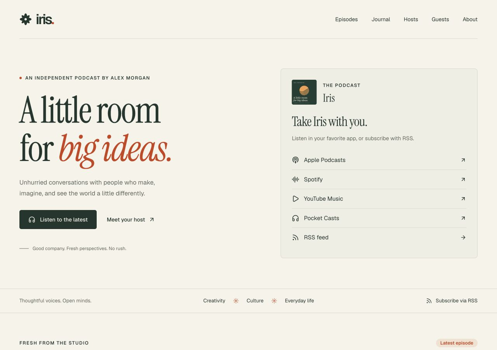

<p align="center">
  
</p>

<h1 align="center">Iris</h1>

<p align="center">
  <strong>A podcast-first Astro template for independent voices.</strong><br />
  Give your conversations a home, with audio, show notes, the people behind the microphone,
  and a companion journal.
</p>

<p align="center">
  <a href="https://astro-template-iris.prosefly.dev/">Live demo</a> ·
  <a href="https://astro-template-iris.prosefly.dev/episodes/">Explore episodes</a> ·
  <a href="https://prosefly.com/">Prosefly</a>
</p>

<a href="https://astro-template-iris.prosefly.dev/">
  
</a>

Iris puts listening at the center. Each episode brings together its recording, chapter navigation,
show notes, transcript, hosts, and guests. The journal gives you room for the ideas that continue
after the microphones are off.

Built with [Prosefly Components](https://prosefly.com/), Iris pairs Instrument Serif with Geist,
a warm paper palette, and generous spacing. Content lives in Markdown, MDX, and YAML. The site
builds to static files, with no database or server runtime to manage.

## Why Iris

- **A complete listening experience.** A featured episode on the homepage and Prosefly’s
  AudioPlayer with artwork, seeking, playback speed, and skip controls. Episode pages include
  chapter navigation, audio downloads, show notes, and transcripts.
- **The people are part of the story.** Define hosts and guests once in YAML, then reference them
  from episodes. Profiles collect their recent appearances, and journal authors use the same host
  data.
- **A podcast feed with more context.** Audio enclosures, show and episode artwork, full HTML show
  notes, iTunes metadata, and Podcast Namespace support for transcripts, chapters, and people.
- **Writing alongside listening.** A companion journal with author profiles and optional links to
  related episodes, plus its own RSS feed.
- **Room for a growing catalog.** Paginated archives, topic filters, and episode search across the
  full catalog. Static pagination also works without JavaScript.
- **Make it sound—and look—like you.** Configure listening platforms freely, and customize colors,
  typography, spacing, and player styling through one `token.css` file.
- **Built beyond the homepage.** Responsive layouts, keyboard focus styles, reduced-motion
  support, self-hosted fonts, canonical URLs, a sitemap, an About page, and a custom 404 page.

## Quick start

Requires Node.js **22.12 or newer** and npm **9.6.5 or newer**. Clone or download this repository,
then run these commands from its directory:

```sh
npm install
npm run dev
```

Open the local URL printed by Astro, usually `http://localhost:4321`.

## Make it yours

1. **Set up your show.** Update the title, description, production URL, language, feed owner,
   artwork, navigation, and listening platforms in
   [`src/data/config.ts`](src/data/config.ts).
2. **Introduce your people.** Replace the demo profiles in
   [`src/data/hosts.yaml`](src/data/hosts.yaml) and
   [`src/data/guests.yaml`](src/data/guests.yaml). Add portraits in `public/people/`.
3. **Publish your conversations.** Add episodes to `src/content/episodes/` and journal posts to
   `src/content/blog/`. Point episodes at your audio files and square PNG/JPEG covers.
4. **Adjust the design.** Edit [`src/styles/token.css`](src/styles/token.css), the logo in
   [`src/components/Brand.astro`](src/components/Brand.astro), and the homepage and About copy.

The demo uses `https://astro-template-iris.prosefly.dev/` as its production URL. Replace it before
publishing on your own domain so canonical links, media references, and feeds point to your site.
The included listening links use platform homepages; swap them for your show’s direct listings.

## Content at a glance

An episode’s frontmatter connects the recording, artwork, and people:

```yaml
---
title: A conversation worth keeping
description: A short introduction to this conversation.
publishedAt: 2026-10-14
category: Creativity
number: 5
season: 1
hosts:
  - alex-morgan
guests:
  - elliot-reed
artwork: /images/your-episode.png
audio:
  src: https://media.example.com/your-episode.mp3
  type: audio/mpeg
  size: 12345678 # Actual file size in bytes
  duration: '40:00'
chapters:
  - title: Getting started
    start: '00:00'
  - title: Finding a practice
    start: '10:20'
---
```

Write show notes in Markdown or MDX below the frontmatter. A `## Transcript` section automatically
provides a separate TXT transcript for the feed. To reference an existing transcript file, add a
single URL:

```yaml
transcript: https://media.example.com/your-episode.vtt
```

VTT, SRT, TXT, HTML, and JSON types are inferred from the URL suffix. Duration and chapter start times
accept quoted `MM:SS` or `HH:MM:SS` timestamps, as well as numeric seconds. Journal posts reference
host IDs through `authors` and can link to an episode with `episode: your-episode`.

| Guide                                  | What it covers                                                             |
| -------------------------------------- | -------------------------------------------------------------------------- |
| [Content](docs/content.md)             | People, episodes, journal posts, media metadata, and draft behavior        |
| [Customization](docs/customization.md) | Site settings, listening links, typography, theme tokens, and pagination   |
| [Podcast RSS](docs/rss.md)             | Show notes, artwork, transcripts, chapters, people credits, and publishing |

## Built with

| Foundation               | What it provides                                                                    |
| ------------------------ | ----------------------------------------------------------------------------------- |
| Astro 7                  | Static pages, validated content collections, routing, feeds, and sitemap generation |
| Markdown + MDX + YAML    | Portable writing and reusable host and guest data                                   |
| Prosefly Components      | AudioPlayer, Icon, Badge, and Callout                                               |
| CSS custom properties    | A shared theme for page styles and Prosefly components                              |
| Geist + Instrument Serif | Clear reading text and expressive editorial titles                                  |

No frontend framework is required. JavaScript enhances playback and catalog filtering; content
pages and archive pagination are generated as HTML.

## Commands

| Command                | Action                                  |
| ---------------------- | --------------------------------------- |
| `npm run dev`          | Start the development server            |
| `npm run check`        | Check Astro, TypeScript, and content    |
| `npm run build`        | Generate the static site in `dist/`     |
| `npm run preview`      | Preview the production build locally    |
| `npm run format`       | Format the project                      |
| `npm run format:check` | Check formatting without changing files |

## Deploy

```sh
npm run check
npm run build
```

Deploy `dist/` to your static host. A [GitHub Pages workflow](.github/workflows/site.yml) is included;
you can also deploy the build output to Cloudflare Pages, Netlify, or another static host.

Clean builds need internet access to resolve Prosefly’s Iconify icons. The generated site serves
its fonts and icons locally; audio is loaded from the URL you supply for each episode.

## Demo content and credits

The show, people, and writing are fictional. Demo recordings are short, synthetic host monologues
made with [Kokoro](https://huggingface.co/hexgrad/Kokoro-82M) through
[kokoro-onnx](https://github.com/thewh1teagle/kokoro-onnx), and are hosted remotely. Transcripts and
chapter times match those recordings. Portraits are AI-generated; their prompts are saved in
[`scripts/avatar-prompts.json`](scripts/avatar-prompts.json). Editable SVG artwork and 1600 × 1600
PNG covers are included in `public/artwork/` and `public/images/`.

## License

[BSD-3-Clause](LICENSE). Font licenses are provided by their Fontsource packages.
